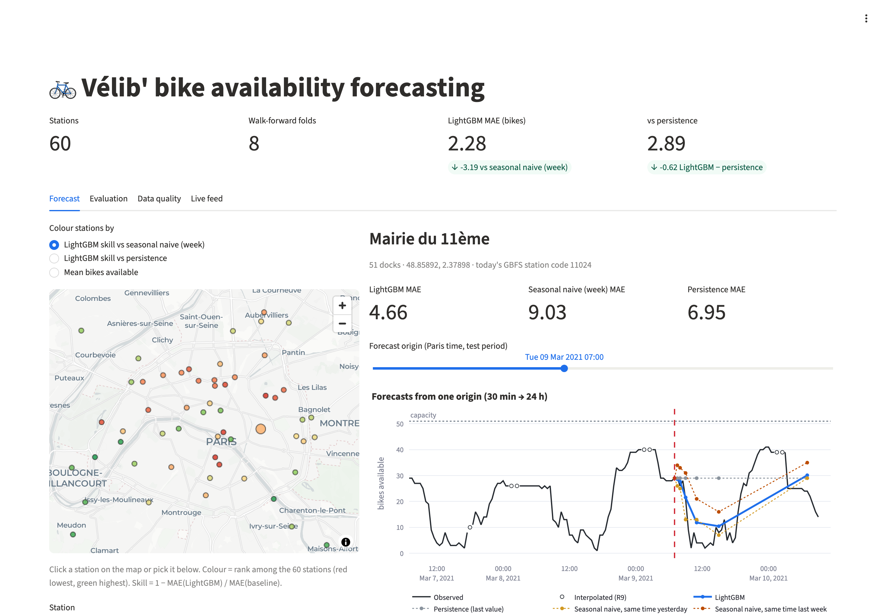
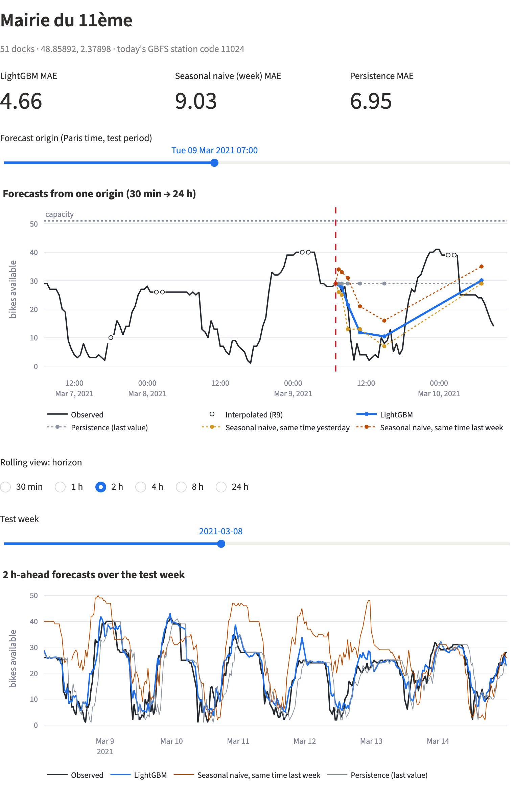
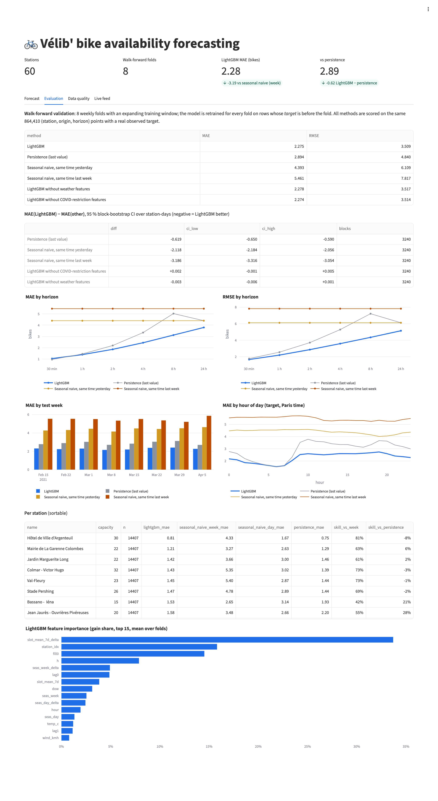
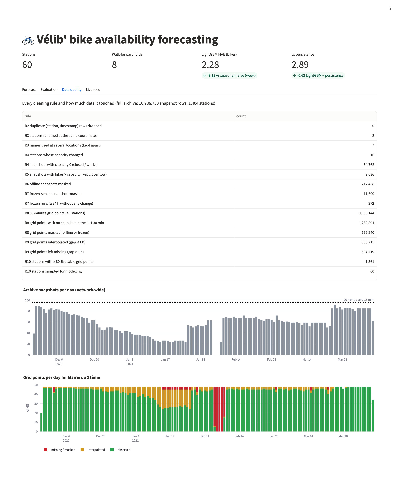
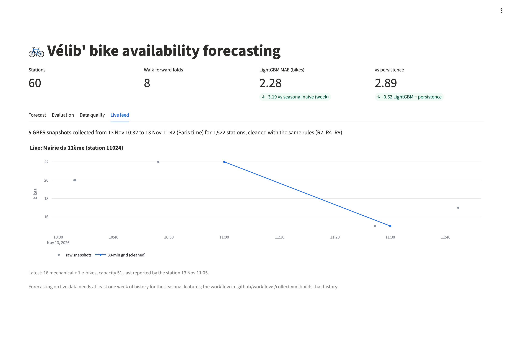

# Vélib' Availability Forecasting

**Forecasting how many bikes will be at a Paris Vélib' station from 30 minutes to 24 hours ahead, built on
messy real open data and tested with walk-forward validation against honest baselines.**

Vélib' publishes the live state of its ~1,500 stations as an open GBFS feed, but nobody publishes the history.
To get it, this project uses a community archive of 11 million snapshots, cleans it with 10 documented rules
(irregular sampling, missing days, offline stations, stuck sensors, capacity changes, stations with no ID), and
resamples it onto a 30-minute grid. It then trains one LightGBM model across 60 stations and 6 horizons and
scores it in 8 weekly walk-forward folds against persistence and seasonal-naive baselines. A small collector
(local script or GitHub Actions cron) keeps gathering fresh snapshots from the live feed, and a Streamlit app
shows the map, forecasts against what actually happened, the metrics and the data-quality report.

`Python 3.11` · `pandas` · `LightGBM` · `Streamlit` + `pydeck` + `Plotly` · `Open-Meteo` weather ·
`GitHub Actions` (scheduled collector + tests) · `pytest`

---

## Demo

Screenshots from the running app (`streamlit run app/app.py`). They are regenerated by
`python scripts/screenshots.py` with headless Chromium.

**Forecast tab.** The map colours the 60 stations by how much LightGBM beats a baseline. Click a station (or pick
it from the list) and choose a forecast origin. Here it is Tuesday 9 March 2021 at 07:00, Mairie du 11ème. The
commuter rush empties the station between 08:00 and 10:00: LightGBM (blue) predicts the drop, while persistence
(grey) stays flat at 30 bikes.



**The same station over a whole test week**, 2-hour-ahead forecasts. LightGBM follows the daily cycle; last
week's values (orange) are often off by 10 to 20 bikes, because the station does not repeat itself from week to week.



**Evaluation tab**: overall table, bootstrap confidence intervals, error by horizon, by test week and by hour of
day, per-station metrics and feature importance.



**Data-quality tab**: what every cleaning rule touched, how many snapshots the archive has per day (it never
reaches the nominal 96), and which grid points of the selected station are observed, interpolated or missing.



**Live-feed tab**: snapshots from the project's own GBFS collector, cleaned by the same code. The archive station
is matched to today's station code by coordinates (58 of the 60 stations still exist within 60 m).



A view can be shared as a link: `http://localhost:8501/?station=Mairie%20du%2011ème&origin=2021-03-09T07:00`.

---

## Contents

1. [Demo](#demo)
2. [Headline results](#headline-results)
3. [Why this project](#why-this-project)
4. [Architecture](#architecture)
5. [Data](#data)
6. [Cleaning rules](#cleaning-rules)
7. [Features and model](#features-and-model)
8. [Validation scheme](#validation-scheme)
9. [Full results](#full-results)
10. [Quick start](#quick-start)
11. [Collecting live data](#collecting-live-data)
12. [Testing and CI](#testing-and-ci)
13. [Project layout](#project-layout)
14. [Limitations](#limitations)
15. [Next steps](#next-steps)

---

## Headline results

60 stations, 8 weekly walk-forward folds (15 February – 9 April 2021), 6 horizons. All methods are scored on the
same **864,410** (station, origin, horizon) points whose target is a real observation, not an interpolated or
masked one. Errors are in **bikes**; the median station has 29 docks and about 12 bikes on average.

| method | MAE | RMSE |
|---|---:|---:|
| seasonal naive: same time last week | 5.461 | 7.817 |
| seasonal naive: same time yesterday | 4.393 | 6.109 |
| persistence: last observed value | 2.894 | 4.840 |
| **LightGBM (shipped)** | **2.275** | **3.509** |
| LightGBM without weather features | 2.278 | 3.517 |
| LightGBM without COVID-restriction features | 2.274 | 3.514 |

**MAE difference, LightGBM minus baseline**, with a 95 % block-bootstrap CI that resamples whole station-days (3,240
blocks):

| vs | Δ MAE | 95 % CI | relative |
|---|---:|---|---:|
| seasonal naive (week) | **−3.19** | [−3.32, −3.05] | −58 % |
| seasonal naive (day) | **−2.12** | [−2.18, −2.06] | −48 % |
| persistence | **−0.62** | [−0.65, −0.59] | −21 % |

### By horizon (MAE, bikes)

| horizon | persistence | seasonal naive (day) | seasonal naive (week) | **LightGBM** | LightGBM vs best baseline, 95 % CI |
|---|---:|---:|---:|---:|---|
| 30 min | **0.957** | 4.395 | 5.462 | 1.042 | +0.086 [+0.079, +0.092] *worse* |
| 1 h | 1.453 | 4.393 | 5.462 | **1.393** | −0.060 [−0.071, −0.050] |
| 2 h | 2.199 | 4.391 | 5.461 | **1.860** | −0.339 [−0.361, −0.317] |
| 4 h | 3.344 | 4.393 | 5.461 | **2.445** | −0.899 [−0.948, −0.852] |
| 8 h | 5.027 | 4.393 | 5.461 | **3.122** | −1.270 [−1.338, −1.200] |
| 24 h | 4.395 | 4.395 | 5.461 | **3.798** | −0.598 [−0.656, −0.548] |

### Key findings

1. **The seasonal-naive baseline is weak here; persistence is the real bar.** "Same time last week" is the worst
   method at every horizon. Station counts drift over days (rebalancing trucks, events, weather), so a week-old
   value is often 10+ bikes off. Persistence is far stronger up to about 4 h, so beating only the seasonal
   baseline would prove little.
2. **LightGBM does not beat persistence at 30 minutes.** It is 0.09 bikes worse, and the CI excludes zero. Over half
   an hour most stations barely move, and the model's small predicted changes add more noise than signal. From 1 h
   on, LightGBM wins at every horizon, with the largest gain at 8 h (−1.9 bikes vs persistence, −1.3 vs the best
   baseline). In production the 30-minute forecast should simply be the last value.
3. **The gain is during the day.** For targets between 04:00 and 08:00 LightGBM and persistence are within
   0.05 bikes, because nothing moves. From 09:00 to midnight LightGBM's MAE is 0.5–1.2 bikes lower, with the
   largest gaps around the morning and evening peaks (see the hour-of-day chart).
4. **The strongest feature is "how this slot usually changes".** `slot_mean_7d_delta` (the average change between
   the origin's time slot and the target's time slot over the last 7 days) carries 32 % of the gain, ahead of
   the station identity (15 %) and the current fill ratio (14 %). The model is mostly learning *when* each station
   fills and empties, then anchoring that on the current value.
5. **Weather and COVID-restriction features add nothing measurable.** Removing them changes MAE by +0.003 and
   −0.002 bikes, with CIs that include zero. Both effects are already in the recent lags and same-slot features,
   and two months of winter data hold few rainy commuter peaks to learn from. Both feature groups stay in the
   model because they cost nothing, but the README does not claim they help.
6. **It holds up when the regime shifts.** The last fold (5–9 April 2021) starts on Easter Monday, right after
   France's third lockdown began (3 April). Seasonal naive (week) has its worst week there (5.86); LightGBM's MAE
   is 2.26, in line with the other folds (2.15–2.40).
7. **LightGBM wins at 55 of 60 stations against persistence and at all 60 against both seasonal baselines.** The 5
   where persistence wins are quiet suburban stations (MAE < 1.5 bikes) where "nothing changes" is nearly always
   right.

---

## Why this project

Bike-share availability is a standard example of operational time-series forecasting: many related series,
strong daily and weekly seasonality, regime changes, and data that is genuinely messy. It is the kind of problem
where the modelling choice matters less than (a) cleaning the data honestly, (b) validating the way the model
would actually be used, and (c) comparing against baselines strong enough to make the comparison mean something.
This repository is built around those three points:

- **Real data, real defects.** No Kaggle CSV: an archive scraped by a third party, with collector outages, a
  3.8-day hole, no station IDs, and a mix of station states. Every defect gets a numbered rule with a count.
- **Walk-forward evaluation.** Eight weekly folds with retraining, never a random split.
- **Honest comparison.** Persistence and two seasonal-naive baselines on exactly the same points, block-bootstrap
  CIs, results by horizon, by station and by hour, including where the model loses.

---

## Architecture

```
  ┌──────────────────────────────┐        ┌──────────────────────────────┐
  │ lovasoa/historique-velib-    │        │ Vélib' GBFS feed (live)      │
  │ opendata archive (236 MB zip)│        │ station_status + _information│
  │ 26 Nov 2020 – 9 Apr 2021     │        └──────────────┬───────────────┘
  └──────────────┬───────────────┘                       │ scripts/collect.py
                 │ ingest.py (chunked, low memory)       │ local loop or GitHub Actions cron
                 ▼                                       ▼   (orphan `snapshots` branch)
  ┌─────────────────────────────────────────────────────────────────────────┐
  │ unified raw schema: ts, station_key, name, capacity, bikes_mech,        │
  │                     bikes_ebike, operative, source                      │
  └──────────────────────────────────┬──────────────────────────────────────┘
                                     ▼  clean.py  (rules R1–R10, report → artifacts/cleaning_report.json)
  ┌─────────────────────────────────────────────────────────────────────────┐
  │ 30-minute panel: y (observed) · y_filled (≤ 1 h gaps interpolated) ·     │
  │ observed / imputed flags · capacity · 60 sampled stations               │
  └──────────────────────────────────┬──────────────────────────────────────┘
                                     ▼  features.py   + Open-Meteo hourly weather
  ┌─────────────────────────────────────────────────────────────────────────┐
  │ direct multi-horizon table: (station, origin t, horizon h) → y(t+h)     │
  │ lags · same-slot yesterday / last week / 7-day mean · calendar ·         │
  │ holidays · COVID restrictions · weather            2.2 M rows           │
  └──────────────────────────────────┬──────────────────────────────────────┘
                                     ▼  evaluate.py
  ┌─────────────────────────────────────────────────────────────────────────┐
  │ walk-forward: 8 weekly folds, expanding window, retrain per fold         │
  │ persistence · seasonal naive (day, week) · LightGBM (+ 2 ablations)     │
  │ MAE / RMSE overall · per horizon · per station · per hour · bootstrap CI│
  └──────────────────────────────────┬──────────────────────────────────────┘
                                     ▼
                   artifacts/*.csv|json  +  data/processed/predictions.parquet
                                     ▼
                         Streamlit app (app/app.py)
```

`python -m velib.pipeline` runs ingest → clean → features → evaluate end to end in about 15 minutes on a laptop
(4 threads, peak memory about 2–3 GB). Most of that is LightGBM: 3 variants × 8 folds, each fitted twice (early stopping, then a refit on the full window). Cleaning 11 M rows takes 10 seconds.

---

## Data

| source | what | used for |
|---|---|---|
| [lovasoa/historique-velib-opendata](https://github.com/lovasoa/historique-velib-opendata) release `stations.zip` | 10,986,730 rows: one row per station per snapshot, 26 Nov 2020 – 9 Apr 2021, 1,404 stations | history for training and evaluation |
| [Vélib' Métropole GBFS](https://www.velib-metropole.fr/donnees-open-data-gbfs-du-service-velib-metropole) (`station_status.json`, `station_information.json`) | live state, ~1,520 stations | the project's own collector; today's station codes |
| [Open-Meteo archive API](https://open-meteo.com/en/docs/historical-weather-api) | hourly temperature, precipitation, wind for central Paris | weather features |

**Why an archive and a collector.** Paris open data ([opendata.paris.fr](https://opendata.paris.fr), "Vélib - Vélos
et bornes - Disponibilité temps réel") and the GBFS feed only give the *current* state. The only substantial
public history I found is the archive above, collected by a third party every ~15 minutes via a scheduled job
until April 2021. It is used as-is and re-downloaded by the pipeline, never committed. The collector in this
repo builds a fresh history going forward (see [Collecting live data](#collecting-live-data)).

**What the archive looks like** (no header, no station ID):

```
2021-03-09T07:00Z,51,22,7,Mairie du 11ème,"48.85892,2.37898",True
 time (UTC)     cap mech ebike  name           coordinates     operative
```

The timestamp is when the scraper ran, not when the station reported. The archive window is entirely inside
COVID-19 restrictions: the second lockdown (until 14 Dec 2020), a 20:00 and then 18:00 curfew, the 19:00 curfew
with "confinement light" from 20 March, and the third national lockdown from 3 April 2021. That is unusual
demand, so the [limitations](#limitations) discuss what it means for the results.

**Station sample.** 60 stations, a seeded random draw from the 1,361 stations that pass the coverage rule (R10).
That keeps the feature table at 2.2 M rows (fits in memory on a 16 GB laptop with room to spare) while covering
central Paris, the inner suburbs and a few outer ones, small (14 docks) to large (68 docks) stations.

---

## Cleaning rules

Implemented in [`src/velib/clean.py`](src/velib/clean.py); counts are from
[`artifacts/cleaning_report.json`](artifacts/cleaning_report.json) (full archive, all 1,404 stations).

| rule | what it does | count |
|---|---|---:|
| R1 | Rows with an unparseable timestamp, coordinates or flag are dropped at ingest. | 0 rows |
| R2 | Duplicate (station, timestamp) rows: keep the last one received. | 0 in the archive; the live collector produces some (two runs in the same second) |
| R3 | **Station identity = coordinates**, since the archive has no ID. A rename at the same coordinates is the same station; the same name at different coordinates is a different station. | 2 renamed stations; 7 names used at 2 locations |
| R4 | Capacity is kept per snapshot, not per station (it changes). Capacity 0 = closed / under works → treated as offline. | 16 stations change capacity; 64,762 capacity-0 rows |
| R5 | Bikes > capacity is **kept**: Vélib' stations accept overflow bikes, so it is not an error. | 2,036 rows |
| R6 | `operative = False` (or capacity 0) → the count is masked: it says nothing about demand. | 217,468 rows |
| R7 | **Frozen sensor**: an operative station whose (mechanical, e-bike) counts do not change at all for 24 h is stuck, not quiet; masked. | 272 runs, 17,600 rows |
| R8 | **Resampling**: each 30-minute grid point (UTC) takes the latest snapshot at or before it, if it is at most 30 minutes old (as-of join). Snapshots arrive irregularly: median gap 21 min, mean 25 min, 5 gaps > 2 h, the longest 3.8 days (4 Feb 18:54 → 8 Feb 14:40 UTC). | 9,036,144 grid points; 1,282,894 with no snapshot; 165,240 masked |
| R9 | **Gaps of ≤ 2 grid points (1 h)** are linearly interpolated and flagged `imputed`; longer gaps stay missing. Imputed values may be model *inputs*, never training or evaluation *targets*. | 880,715 imputed; 567,419 left missing |
| R10 | Station eligibility: ≥ 80 % usable grid points and a standard deviation > 1 bike (a station that never changes is not a forecasting problem); then a seeded sample of 60. | 1,361 eligible, 60 selected |

After cleaning, the 60 selected stations have 85.8 % observed grid points, 10.0 % interpolated and 4.2 % missing.
The worst stretch is January 2021, when the archive's scraper only managed ~25 snapshots a day instead of ~90
(visible in the data-quality tab).

**Time zones.** Everything is stored in UTC. Calendar features (hour, day of week, holidays, curfew) are computed
in Europe/Paris, so the 28 March 2021 daylight-saving switch moves the commuter peaks by one UTC hour without
confusing the model. A test checks this.

---

## Features and model

**Framing: one direct multi-horizon model.** Each row is (station, origin *t*, horizon *h*), with
*h* ∈ {1, 2, 4, 8, 16, 48} half-hours (30 min to 24 h) and the horizon as a feature. One model is trained for all
stations and horizons (2.2 M rows), with the station as a categorical feature. The target is the **change**
y(t+h) − y(t), which tree models handle better than levels; the forecast is y(t) + change, clipped to
[0, 1.1 × capacity + 2].

| group | features (all known at origin *t*) |
|---|---|
| recent values | `lag0`, `lag1`, `lag2`, `lag4`, `lag8`, differences `d1`, `d4`, fill ratio `fill0 = lag0 / capacity` |
| same slot in the past | value at the target's time slot yesterday (`seas_day`) and last week (`seas_week`), their mean over the last 7 days (`slot_mean_7d`), and the *change* between origin slot and target slot on those days (`*_delta`) |
| station | `station_idx` (categorical), `lat`, `lon`, `capacity` |
| calendar (target time, Paris) | `hour`, `dow`, `weekend`, public `holiday`, Paris `school_holiday` |
| COVID restrictions (target time) | `lockdown` level, `curfew_start` hour, `hours_to_curfew`, all from announced dates |
| weather | temperature, precipitation and wind at the target hour; precipitation over the 3 h before the origin |
| horizon | `h` |

**Weather is observed, not forecast.** The hourly weather at the target time stands in for a weather forecast.
Up to 24 h ahead a real forecast would be close, but this is a mild optimistic bias, and it turned out not to
matter (finding 5).

**LightGBM settings** were fixed before looking at any test fold: `l2` objective, learning rate 0.05, 63 leaves,
`min_data_in_leaf` 200, feature/bagging fraction 0.8, L2 regularisation 1.0, 4 threads. The number of trees is
chosen by early stopping on the **last 7 days of each training window** (never on the test week), then the model
is refit on the full window with that number of trees (56 to 999 trees across folds).

---

## Validation scheme

```
time ─────────────────────────────────────────────────────────────────────────────────────────►
26 Nov 2020                                         15 Feb   22 Feb   1 Mar   …   5 Apr  9 Apr
fold 0  [========== train (targets < 15 Feb) ==========][test]
fold 1  [============== train (targets < 22 Feb) ==============][test]
  …
fold 7  [===================== train (targets < 5 Apr) ======================================][test]
                                  └ last 7 days of each training window = early-stopping set
```

- **Expanding origin, weekly folds.** Folds are calendar weeks in Paris time (Monday 00:00), so the DST switch does
  not shift them. The model is retrained from scratch for each fold.
- **No leakage through the target.** A training row is used only if its *target time* is before the fold
  starts; filtering on origin time alone would let a 24 h-ahead target from inside the test week leak in.
  Features at origin *t* only use values at or before *t* (tests check that every lag and seasonal feature points
  backwards in time).
- **Same scoring set for every method**: test rows whose target is a real observation (not imputed, offline or
  frozen) and for which every baseline is defined, which is 864,410 of 877,260 observed-target rows. The other
  1.5 % are rows where last week's value is missing.
- **Baselines**: persistence (last observed value), seasonal naive same time yesterday, seasonal naive same time
  last week. At the 24 h horizon, "same time yesterday" *is* the last value, which is why those two columns match.
- **Uncertainty**: errors within a station-day are strongly correlated, so CIs come from a block bootstrap that
  resamples whole station-days (2,000 resamples; 1,000 per horizon). Resampling single rows would give intervals
  that are far too narrow.

---

## Full results

All numbers are in [`artifacts/`](artifacts/): `metrics.json` (overall, CIs, folds, parameters),
`metrics_by_horizon.csv`, `metrics_by_fold.csv`, `metrics_by_station.csv`, `metrics_by_hour.csv`,
`feature_importance.csv`, `cleaning_report.json`, `stations.csv`.

### RMSE by horizon

| horizon | persistence | seasonal naive (day) | seasonal naive (week) | **LightGBM** |
|---|---:|---:|---:|---:|
| 30 min | 1.773 | 6.111 | 7.817 | **1.659** |
| 1 h | 2.552 | 6.109 | 7.817 | **2.200** |
| 2 h | 3.706 | 6.107 | 7.816 | **2.858** |
| 4 h | 5.286 | 6.107 | 7.816 | **3.584** |
| 8 h | 7.208 | 6.109 | 7.816 | **4.344** |
| 24 h | 6.113 | 6.113 | 7.818 | **5.145** |

At 30 minutes LightGBM has a lower RMSE than persistence even though its MAE is higher: it makes fewer large
misses (when a station is about to be emptied or refilled) but many small ones.

### MAE by test week

| test week (Mon) | persistence | seasonal naive (day) | seasonal naive (week) | **LightGBM** | note |
|---|---:|---:|---:|---:|---|
| 15 Feb 2021 | 2.771 | 4.259 | 5.536 | **2.302** | winter school holidays |
| 22 Feb | 2.889 | 4.315 | 5.533 | **2.228** | winter school holidays |
| 1 Mar | 3.025 | 4.449 | 5.503 | **2.291** | |
| 8 Mar | 2.704 | 4.147 | 5.335 | **2.147** | |
| 15 Mar | 2.829 | 4.486 | 5.513 | **2.191** | |
| 22 Mar | 3.036 | 4.427 | 5.359 | **2.370** | "confinement light" starts 20 Mar |
| 29 Mar | 3.119 | 4.498 | 5.203 | **2.398** | DST switch 28 Mar; national lockdown 3 Apr |
| 5 Apr (4 days) | 2.692 | 4.626 | 5.857 | **2.263** | Easter Monday; schools closed |

### Per station

Skill = 1 − MAE(LightGBM) / MAE(baseline), over the 60 stations:

| | min | median | mean | max |
|---|---:|---:|---:|---:|
| skill vs seasonal naive (week) | 34 % | 51 % | 54 % | 81 % |
| skill vs persistence | −8 % | 20 % | 19 % | 45 % |

Error scales with how busy a station is: LightGBM's MAE runs from 0.81 bikes (Hôtel de Ville d'Argenteuil, a
quiet suburban station) to 4.66 (Mairie du 11ème, 51 docks, the busiest commuter profile in the sample). The full
table is in the app and in `metrics_by_station.csv`.

### Feature importance (gain share, mean over folds)

`slot_mean_7d_delta` 32 % · `station_idx` 15 % · `fill0` 14 % · `h` 8 % · `seas_week_delta` 5 % · `lag0` 5 % ·
`slot_mean_7d` 4 % · `dow` 3 % · `seas_week` 2 % · `seas_day_delta` 2 % · `hour` 2 %. Weather and COVID features
are below 1 % each, consistent with the ablation.

---

## Quick start

### Requirements

Python 3.11, ~1 GB of free disk (236 MB archive + derived parquet files), 3 GB of free RAM. On macOS
LightGBM needs OpenMP: `brew install libomp`.

### Install and run the pipeline

```bash
python3.11 -m venv .venv && source .venv/bin/activate
```

```bash
pip install -e ".[dev]"
```

```bash
python -m velib.pipeline
```

That downloads the archive, cleans it, builds features, fetches weather, runs the walk-forward evaluation and
writes `artifacts/` and `data/processed/`. Individual steps:
`python -m velib.pipeline --step {ingest,clean,features,evaluate}`; `--no-ablations` skips the two ablation
models (about 3× faster).

### Run the app

```bash
streamlit run app/app.py
```

Then open http://localhost:8501. The app reads `data/processed/` and `artifacts/`, so the pipeline must have run
first.

### Regenerate the screenshots

```bash
pip install playwright && playwright install chromium-headless-shell
```

```bash
python scripts/screenshots.py
```

---

## Collecting live data

[`scripts/collect.py`](scripts/collect.py) takes one snapshot of the GBFS feed and appends it to daily gzip CSVs:

```
data/collected/status/YYYY-MM-DD.csv.gz   fetched_at, station_code, last_reported, bikes_mech,
                                          bikes_ebike, docks, is_installed, is_renting, is_returning
data/collected/info/YYYY-MM-DD.csv.gz     fetched_at, station_code, capacity, name, lat, lon
```

Station info is written once a day and again whenever it changes, so capacity changes stay visible in the
history instead of being overwritten. A status snapshot is ~13 kB gzipped, about 1.3 MB a day at 15-minute
sampling. `ingest.load_collected()` joins status and info as-of the snapshot time and maps it to the same raw
schema as the archive, and `clean.clean_collected()` applies the same rules.

Two ways to run it:

- **Locally**: run `python scripts/collect.py` from cron/launchd, or in a loop.
- **GitHub Actions**: [`.github/workflows/collect.yml`](.github/workflows/collect.yml) runs every 15 minutes and
  commits snapshots to an orphan `snapshots` branch, which keeps `main` free of data. GitHub runs scheduled jobs
  on a best-effort basis (often late, sometimes skipped), which is one more source of irregular sampling the
  cleaning step already handles. To use the data:
  `git clone --branch snapshots --single-branch https://github.com/luqman304/velib-forecasting snapshots`
  and copy `snapshots/data/` to `data/collected/`.

---

## Testing and CI

```bash
pytest -q
```

10 offline tests (no network) cover the cleaning rules: duplicates, offline masking, frozen-run detection, as-of
tolerance, interpolation only for short gaps, masked points never being targets. They also check the feature
table (every target is in the future and every lag and seasonal feature in the past; curfew and DST handling)
and the collector (bike-type parsing, multi-member gzip round trip). GitHub Actions runs them on every push to
`main` and on pull requests.

---

## Project layout

```
src/velib/
  config.py         paths, horizons, cleaning thresholds, fold dates
  ingest.py         archive download + chunked CSV→parquet, live-snapshot loader, weather, GBFS station list
  clean.py          rules R1–R10, 30-minute as-of resampling, cleaning report
  features.py       direct multi-horizon feature table, calendar / holiday / COVID features
  evaluate.py       baselines, LightGBM training, walk-forward folds, metrics, block bootstrap
  pipeline.py       `python -m velib.pipeline` (ingest → clean → features → evaluate)
app/app.py          Streamlit app (map, forecasts, evaluation, data quality, live feed)
scripts/collect.py  GBFS snapshot collector (used locally and by the GitHub Actions cron)
scripts/screenshots.py  README screenshots with headless Chromium
artifacts/          committed results: metrics, cleaning report, station table, feature importance
docs/screenshots/   README images
tests/              offline pytest suite
.github/workflows/  collect.yml (every 15 min) · tests.yml
data/               git-ignored, rebuilt by the pipeline
```

---

## Limitations

- **COVID-era demand.** The only public history covers November 2020 – April 2021: lockdowns, curfews, remote
  work. Daily profiles were flatter and evenings shorter than in a normal year, so the absolute errors here
  would not transfer directly to 2026 demand. The method transfers; the numbers would need re-measuring on newly
  collected data.
- **Eight weeks of test data, one winter.** No summer, no tourist season, no long rain spells in the evaluation,
  which also limits what the weather features could show.
- **60 of ~1,400 stations.** A random sample keeps the problem laptop-sized. The pipeline runs on every station by
  raising `N_STATIONS` in `config.py`, at roughly 25× the training time.
- **Station identity from coordinates.** Without IDs, a station that is moved a few metres becomes a new series.
  One sampled station shows this: *Chabanais – Petits Champs* was rebuilt 27 m away on 9 December 2020. The old
  location only ever reported capacity 0 / not operative, and the new one starts that day, so splitting them
  loses nothing here. A *working* station that moved would be cut in two, though.
- **Observed weather as a forecast stand-in** (see above). It made no measurable difference, but a production
  system would use archived weather *forecasts*.
- **Total bikes only.** Mechanical and electric bikes are summed; e-bike availability matters a lot to riders
  and would be a separate target.
- **Point forecasts.** No prediction intervals yet. Riders care about "will there be at least one bike", which is a
  probabilistic question.
- **The archive is third-party data.** It was scraped by someone else with their own outages (handled by the
  cleaning rules) and could disappear. The collector exists so the project does not depend on it.

## Next steps

- Use persistence for the 30-minute horizon (it wins there) and LightGBM from 1 h, and report the blended system.
- Quantile LightGBM (or conformal intervals on the walk-forward residuals) for P(bikes ≥ 1) and P(docks ≥ 1).
- Separate targets for mechanical and electric bikes.
- Once the collector has 4+ weeks of 2026 data, rerun the same walk-forward evaluation on post-COVID demand and
  compare the two regimes.
- A hierarchical / global deep model (N-BEATS, TFT) as a second real model, judged against the same baselines.

---

Data: Vélib' Métropole open data (GBFS). Historical snapshots from
[lovasoa/historique-velib-opendata](https://github.com/lovasoa/historique-velib-opendata), downloaded at run time and
not redistributed here. Weather from [Open-Meteo](https://open-meteo.com) (CC BY 4.0).
